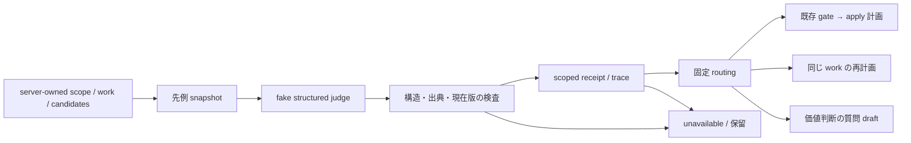

# 意味判断の最初の検収スライス（T01〜T06）

このスライスは、合成の性能目標と観測を使い、`apply_precedent`・`reframe`・`escalate` を検査可能な契約にします。モデルの判断は実行許可ではありません。実行、通知、承認変更、本番の dot 接続は追加していません。

対象は `offline_fixture` の依存注入です。実モデルの意味品質、実 provider の取消保証、実環境 shadow、WorkItem の縦断実行、改善の再観測と学習再利用は未検証・未実装です。最初の検収後に T07 以降で扱います。

検収後の追加分と未接続の境界は [継続実装の記録](./semantic-judgment-continuation.ja.md) に記録します。この文書の検証結果は最初のスライスの範囲です。

## 境界と責務

| 層   | ファイル                                      | 保証する範囲                                                                                                    |
| ---- | --------------------------------------------- | --------------------------------------------------------------------------------------------------------------- |
| 契約 | `libs/core/organization/judgment-contract.ts` | strict 三分岐、server binding 分離、有限数・件数・文字数・UTF-8 上限                                            |
| 先例 | `judgment-precedents.ts`                      | 明示 case allowlist と完全 scope 一致を読取前に確認し、人間の active/decided 判断と構造化 goal を版 hash へ結合 |
| 検証 | `judgment-validation.ts`                      | 現在 snapshot・全 binding・観測 hash・既知 operation・全目標の出典を照合。apply は元目標不変かつ費用範囲内      |
| 推論 | `semantic-judgment.ts`                        | fake invoke port へ1回、retry 0。前後の fresh context、親予算、期限、取消、出力量、usage を検査                 |
| 保存 | `judgment-evidence.ts`                        | 同 scope の immutable receipt と最小 trace を保存。採用時は最新版・hash・現在 context・期限を再検証             |
| 経路 | `judgment-routing.ts`                         | 固定ルート、既存 gate を通した計画、同じ work の再計画、質問 draft。executor や送信口は持たない                 |

先例の実 ledger adapter は接続していません。`DecisionRecord` だけから tenant/org/project の対応を推測せず、trusted fixture adapter が case と要求 scope の完全一致を供給します。構造化 latency goal も decision の既存 field とは扱わず、決定の版に結び付いた adapter facts です。



## 合成の値と適用条件

fixture の既決目標は100 users、p95 500 ms、追加月額0 JPY、変更範囲は隔離 fixture のみです。65 users / p95 1,800 ms は合成観測であり、実サービスの SLO・実測値ではありません。

`apply_precedent` は元の人数・p95 目標を維持し、費用上限を満たす場合の計画候補です。人数制限や許容遅延の緩和を先例の適用として通しません。`reframe` は全ての元目標を保持し、`escalate` は確認済みの新しい費用比較の質問 draft に限定します。不足情報・矛盾・古い版・運用障害は `unavailable` で、価値判断へ偽装しません。

自由文の意味の正しさや性能改善は pure validator では証明できません。fake 応答の正解は実モデルの精度評価にも数えません。

## immutable attempt と復旧

既存の `writeScopedArtifactAttempt` / `readScopedArtifactAttempt` は artifact floor と scope-local index を再利用します。新しい store・lock・権限はありません。

- full binding の hash を評価 parent key にし、effect identity は trigger・revision・model の変更で変えません。
- 最大128版です。期限内の有効な winner を再利用し、読み取れる最新版が失効した場合にだけ次版を作ります。異なる有効 verdict が競合しても保存済み winner を再検証して採用します。
- 本文保存後・index 前の停止は、同じ writer による index-only 修復です。本文の上書き・延命や、壊れた slot の飛ばしは行いません。
- 最新 index の本文が欠損した場合は履歴復旧待ちです。失効や非実行を推測して次版を作りません。時計逆行・競合 index・上限到達も保留します。
- domain reuse は最新版だけを採用します。時計が戻っても古い参照を再び有効にしません。
- trace は `TraceContext` の ID/hash/ref を whitelist し、同 scope の `log` class artifact として保存します。共有ログの ad-hoc directory や OTLP export は使いません。

保存・trace 登録・再検証の失敗時に `persisted` と報告しません。これらは証拠の採用を制御するもので、モデル呼出しや実効果の exactly-once を保証する仕組みではありません。実効果の owner/claim/lease/quarantine は既存の WorkItem と executor の責務です。

## 再現する検査

依存を install/build 済みの checkout で、以下を実行します。実 tenant・provider・通知先の設定は不要です。

```bash
KYBERION_TEST_LEAK_STRICT=1 pnpm exec vitest run \
  libs/core/organization/judgment-contract.test.ts \
  libs/core/organization/judgment-precedents.test.ts \
  libs/core/organization/judgment-validation.test.ts \
  libs/core/organization/semantic-judgment.test.ts \
  libs/core/organization/judgment-evidence.test.ts \
  libs/core/organization/judgment-routing.test.ts \
  libs/core/workforce/artifact-store.test.ts \
  libs/core/decision-ledger/ledger.test.ts \
  libs/core/decision-ledger/conformance.test.ts \
  libs/core/judge-route.test.ts
pnpm build
pnpm typecheck
```

テストは隔離 root、固定時計・応答・trace ID で行います。`active/shared/tmp/vitest-active-leaks.json` の `created` / `grown` が空であることも確認します。独立レビューと実行結果はミッション evidence に記録し、未実行の検査を成功扱いしません。

この段階には運用 CLI や production 有効化設定はありません。実環境の導入、公開、push/PR/merge/deploy は別の許可範囲です。
