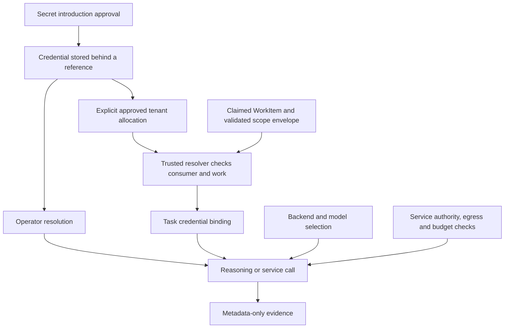

# Credential lifecycle, allocation, and execution boundaries

## Conceptual contract

This document joins secret introduction, provider configuration, tenant allocation,
task dispatch, and API verification. Protocol details remain in the linked
documents. Local allocation management reuses standing grants; narrower optional
limits and graphical management remain target work.

Credentials identify an external account and its provider permissions and billing
relationship. Kyberion separately decides who may use it, for which work, through
which backend, and with what data. A successful call grants none of these rights.

| Concept                 | Responsibility                                                                  | Current source or status                                                                            |
| ----------------------- | ------------------------------------------------------------------------------- | --------------------------------------------------------------------------------------------------- |
| Secret material         | Actual API key, token, or session credential                                    | Existing governed store and secret introduction                                                     |
| Credential reference    | Non-secret name resolving material                                              | `SecretReference`, provider `secret_refs`, canonical secret identity                                |
| Credential owner        | Principal/account controlling rotation and external billing                     | Must be explicit in future allocation management; file placement alone does not establish ownership |
| Credential allocation   | Explicit permission for a consumer tenant to use a reference under restrictions | Human-approved `credential.use` standing grant or configured trusted secret service                 |
| Task credential binding | Temporary supply for one verified execution identity                            | `TaskCredentialBinding`, trusted dispatch after claim validation                                    |
| Backend/model selection | Transport, capabilities, model, and routing limits                              | Provider descriptors, route/backend policies, model registry                                        |
| Verification evidence   | Dated observation in a particular execution context                             | Bounded real API proof; current metadata has limits described below                                 |

Allocation is durable permission; binding is its execution-time realization.
Neither copies a key into a mission, WorkItem, pipeline, or descriptor. One key
can support several models and explicit allocations; one tenant can have several
references. Sharing a key shares external billing, account limits, and rotation
impact. Tenant labels do not partition the provider's account.

The personal data tier, operator execution, tenant identity, organization/project,
and authority role are different axes. A personal file is not a grant. Selecting
a tenant or changing scope does not allocate credentials. Registration authority
does not authorize tenant use. Organization/project constraints may narrow an
allocation; they cannot widen the tenant boundary or replace task binding.

## Lifecycle and independent decisions

Keep these independent instead of maintaining one global `ready` flag:

1. **Introduce:** approve collection and persistence. Pending introduction cannot
   activate a backend as if apply had succeeded.
2. **Allocate:** approve a reference for a named consumer. Personal registration
   never implicitly allocates it to tenants.
3. **Bind:** validate the claim and execution identity, resolve permitted material,
   and limit availability to that task execution.
4. **Select:** choose backend/model and routing limits. Provider account permissions
   determine actual model access; model selection is not an allocation restriction.
5. **Admit:** check service/tool authority, egress, and applicable budgets separately.
6. **Verify:** record what a bounded real call established. Presence, CLI login,
   operator proof, and tenant task proof are different evidence.

Local grants retain the canonical provider and secret reference, consumer tenant,
purpose, human approval, expiry and revocation. Narrower organization/project,
model/operation limits, monetary caps, and external account-owner attestations
remain target semantics. External secret services enforce the restrictions they advertise.

## Execution, rotation, and revocation

Operator introduction dual-writes through the existing secret bridge and personal
connection document, subject to its encryption policy. Operator reference resolution
may read the connection lazily if startup scanning or the OS keychain misses it.
Retain file mediation, plugin grants, and secret masking.

Tenant dispatch invokes `SecretResolver.bindTask` after acquiring the WorkItem
claim and validated scope envelope. The shell adapter checks the claim again after
the service responds. Binding inherits tenant/mission/task identity; nested binding
cannot widen its parent, and cached clients reject another execution identity.

Without an external task binder, dispatch resolves approved local standing grants.
The broker checks the canonical reference and current claim before reading exactly
one connection document under a temporary read-only capability. This is explicitly
allocated consumption, not fallback from a missing tenant key. An external binder's
miss/failure never falls through to the local broker.

Missing binding, an empty bound set, or a missing bound key is final. Never fall
back to operator environment variables, personal connections, or operator CLI login.
Secret-management role changes must preserve tenant/task identity. Tenant execution
cannot register a personal key, including before the OS keychain write begins.

Rotation and revocation are distinct. Local bindings recheck the grant, approval,
expiry, claim and stored key version before subsequent managed API consumption.
Revocation blocks new local bindings and subsequent managed sends; rotation
invalidates an old binding. Already-sent requests are not cancelled. External
binders and spawned CLI sessions retain their own revocation boundaries.

## Readiness and failure attribution

Report presence, allocation, binding, selection, and verification separately.
`registered=true`, `allocated=false`, `binding_required`, and an operator proof
success can coexist.

`reasoning credentials status` reports presence and validates recent proof metadata
against the current key hash, selected model, endpoint, identity and transport
(15-minute freshness). Proofs persist provider, model, timestamp, status/code,
output cap, endpoint, key version hash, operator/tenant and mission/task identity,
and transport. A scoped proof file is not an authorization grant.

Distinguish store permissions, allocation/binding, DNS, connection/TLS, HTTP
authentication, model access/quota, and response validation. `ENOTFOUND` does not
prove an invalid key or tenant denial. Success in one process does not prove
another has the same network path. CLI proofs distinguish DNS, timeout, HTTP
401/403/404/429 and policy failures with fixed safe codes. Other failures remain
`request_failed`; raw errors are not persisted.

## Provider extension and bounded proofs

Use the existing reasoning-provider descriptors and secret-introduction lifecycle when adding an API credential surface. A second provider or credential store creates drift and can bypass tenant credential binding introduced by the shared foundation.

Keep three states distinct: a secret has been introduced, a model/backend has been selected, and a bounded real API request has been verified. Key presence and a working CLI login prove neither API access nor model availability. Model IDs remain separate configuration, so one key can use multiple models permitted by its account.

Declare proof protocol, fixed endpoint, primary secret identity and model environment keys in the canonical provider descriptor. Share request/response adapters by protocol. A compatible provider is a configuration addition; a new protocol supplies a separately registered trusted adapter. Unknown protocols fail before resolving a credential or making a request.

Use only synthetic public input for credential proofs, require explicit acceptance of possible billing, bound output and duration, and disable retries, redirects and fallback. Persist metadata rather than keys, generated text or raw errors. Existing task credential ownership and egress rules still apply to every proof.

## Integration status and next implementation

| Area                                           | State                                                                                                                            |
| ---------------------------------------------- | -------------------------------------------------------------------------------------------------------------------------------- |
| Operator registration, presence, bounded proof | Implemented; recent lazy-resolution/role fixes are local changes in this checkout                                                |
| Trusted per-task tenant binding                | Implemented through resolver, shell protocol, and coordinated dispatch                                                           |
| External allocation decisions                  | Configured external task binders remain authoritative; no fallback on miss                                                       |
| Local allocation management                    | CLI `assign`, `allocations`, `check`, `revoke`; existing standing Grant schema/store and human approval                          |
| Task-path verification                         | `probe` creates a diagnostic WorkItem under an active organization/project-linked mission                                        |
| Versioned proofs and revocation                | Key/context-attributed proofs and per-consumption local checks; no in-flight cancellation                                        |
| Remaining scope                                | Graphical management, narrower model/organization/project limits, account-owner attestations and external/CLI session revocation |

Management integrates with secret references, existing approvals, and
dispatch. Backend activation, scope selection, env copies, and provider registration
cannot stand in for allocation. Acceptance requires consumer-specific approval
without secret-bearing metadata, rejection of unallocated/cross-tenant work, no
operator fallback, honest revocation behavior, and separate operator/tenant evidence.

## Related contracts

- [Secret introduction](./secret-introduction-model.md): naming, approval, collection and persistence.
- [Secret mutation approval](./secret-mutation-approval-model.md): authenticated review and apply.
- [Tenant task binding](../orchestration/tenant-task-credential-binding.ja.md): shell protocol and claim checks.
- [Provider registration and proof operations](../../../docs/developer/REASONING_API_PROVIDERS.ja.md): current commands and extension points.
- [Tenant credential walkthrough](../../../docs/developer/TENANT_CREDENTIALS.ja.md): approval, task probe, revoke and Keychain troubleshooting.
- `libs/core/foundation/credential-binding.ts`: binding identity and no-fallback enforcement.
- `libs/core/secret/task-credential-dispatch.ts`: dispatch/resolver integration.
