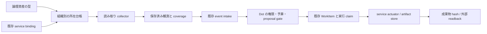

# 情報資産の所在・観測・作業化の接続

情報資産台帳は「何がどこから取得できるか」を組織のスコープで定義する。collector は取得・観測を担当し、intake recipe は観測を既存の Dot proposal / WorkItem に接続する。外部への変更は既存 service actuator の承認と実行の境界を通る。

## 正本と責務

| 対象                        | 正本                                                           | 含めるもの                                                                                                    |
| --------------------------- | -------------------------------------------------------------- | ------------------------------------------------------------------------------------------------------------- |
| 論理資産型                  | `knowledge/product/orchestration/information-asset-types.json` | 型名、alias、説明、既定の鮮度                                                                                 |
| 所在                        | `organizationStateDir(...)/information-assets.json`            | tenant / organization / optional project、binding_id、service / collector、selectors、正本指定、鮮度、version |
| 接続権限と秘密              | 既存 service binding / secret store                            | owner、allowed_actions、approval_policy、secret_refs                                                          |
| 取得状態                    | tenant と組織・project を持つ既存 Dot runtime partition        | cursor、pending page、受理済み観測、coverage                                                                  |
| 作業                        | 既存 WorkItem / Dot action ledger                              | 型付き context、観測への参照、recipe version、claim、実行結果                                                 |
| 明示的な knowledge 取り込み | 既存 ingest asset ledger                                       | source / source_version / version / asset provenance                                                          |

所在は接続の参照を持つ。binding の秘密、承認状態、トークンを台帳に複製しない。`owner_kind: organization` の binding の `owner_ref` は **tenant slug** であり organization_id ではない。組織への所属は、所有者の認可を通した所在登録で確立する。

## 認可と整合性

管理 API は既存の組織所有者の認可を再利用し、organization と project の grant を確認する。mutation は既存管理 lock の取得後に会員・tenant の状態を再確認し、組織・project の現在の親子関係と active 状態を読み直す。catalog 全体の `expectedVersion` による CAS が古い編集の上書きを防ぐ。所在自身の version は更新ごとに増える。

読み取りは現在の実行 tenant / organization と一致するスコープを要求する。project に束縛された実行は組織全体へ拡張できない。project 選択時は、その project の所在だけを先に残し、その後で alias 解決、件数、binding 接続確認、coverage 取得を行う。surface の viewer はサーバーで解決済みの権限から実行スコープを作り、クライアント指定はその範囲を狭めるためだけに使う。

取得直前には所在を再読込し、binding の tenant owner・service・project・action・policy を確認する。collector は返された登録内容が取得開始時の所在と同じことを照合する。preset の operation に `kind: capture` と `risk: read` が明示されていることも必須である。外部書込み用の既存 `authorizeTenantServiceAction` の active mission 要件は変更しない。

台帳は JSON schema 検証を通し、壊れたファイル、重複 ID、異なる tenant / organization の所在、symlink、非 regular file を空台帳として扱わず拒否する。ファイル I/O は secure-io と exact resource capability を使う。

### 統合 authorization registry との対応

境界は `subjectAuthorization` から code 正本の宣言を解決する。`information-asset:catalog:read`、`information-asset:coverage:read`、`chronos.information-assets.read` は local_only / free、`information-asset:catalog:write` は internal_decision / internal admission に対応する。ここで free は追加の効果 admission が不要という分類であり、所有者・viewer・tenant / organization / project・exact resource scope の検証は引き続き必須になる。書込みの internal admission は管理 facade の所有者認可と lock 内の再確認で成立する。

宣言が未登録、別 source、異なる効果、または承認・binding など現在の境界が満たせない authority に変わった場合は、従来の role 判定だけで継続せず拒否する。coverage の role 許可も registry の宣言を先に確認し、その後で exact checkpoint の detail を検証する。宣言は既存の Cedar 互換 serialization に含まれる。ここで別の Cedar evaluator や別の権限ストアを追加しない。

## 利用可能性と観測の違い

resolver の `available` は所在が enabled で、参照する binding の存在・所有者・service・project が整合していることを示す。外部ネットワークの疎通やデータの最新性の証明には使わない。`current` はそれに加えて coverage が complete で鮮度内の場合だけ true になる。`freshness` と `readiness` は未観測、古い観測、partial / failed / full_sync_required、無効化、binding 不整合を区別する。

`authoritative` は情報源の優先順位であり、取得権限の付与や観測の完全性ではない。正本指定の所在を先に安定順で返し、複数候補も残す。alias が複数の論理型に一致すると ambiguous にする。データソースを発見しただけで knowledge への取り込みを発生させない。既存 ingest ledger の projection は、実際に登録済みの source / version と `assetProvenanceRef` を参照する。

## 拡張点と現状の範囲

初期の論理型は `customer.request`、`code.review_request`、`workflow.approval_request`。collector は `gmail.history`、`gmail.followups`、`github.review_requests`、`jira.issues`、`jira.approvals` を typed provider として登録する。collector を追加するときは provider 契約・read preset・ページング・イベント同一性・coverage を実装し、台帳データだけで任意コードをロードしない。

recipe は `information-intake-recipes.json` に version 付きで宣言する。観測の subject / change と recipe version に由来する work key により再観測と再実行を関連付ける。取得自体は completion を意味しない。成果物は実体を読み戻して hash を確認し、外部変更は readback によって確認する。承認待ち、相手待ち、結果不明、再確認待ちを完了へ丸めない。

現行管理 facade は confidential の組織所有接続を対象とする。personal の所在は person owner の認可モデルを追加するまで登録を拒否する。新しい所在 version は collector checkpoint の同一性を変えるため、古い checkpoint を黙って再利用しない。実環境での接続設定、provider の API 権限、既存承認・実行 claim は別途必要で、台帳登録から権限を推定しない。

取得 transport は登録済み binding の auth_mode・target・secret_refs を使い、個人/global connection の暗黙 fallback を利用しない。認証付き取得には tenant に束縛された既存 credential broker の実行 binding が必要になる。対応外の secret reference や未束縛の session は取得を保留する。台帳の `available` はこの broker の準備完了まで証明するものではない。

運用手順は [情報資産運用 runbook](../governance/information-assets-runbook.md) を参照する。
