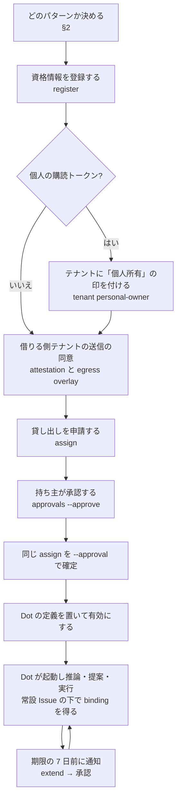

# 推論の資格情報を用意して Dot を動かすまでの流れ

テナントの Dot（常駐エージェント）がモデルを使って考えるには、**誰の資格情報で・どのテナントの仕事に使うか**を決めて、承認しておく必要があります。この手順書は、その準備から日々の運用（延長・差し替え・止め方）までを順に説明します。

設計の理由は [設計書](../../../docs/developer/improvement-plans-2026-11/CLAUDE_CLI_TENANT_CREDENTIAL_DESIGN_2026-11-16.ja.md)、資格情報の根拠（binding）の仕組みは [tenant-task-credential-binding](./tenant-task-credential-binding.ja.md)、テナントとスタンスの関係は [stance-tenant-customer-model](../architecture/stance-tenant-customer-model.md) にあります。

## 1. 全体の流れ



登場する承認は 2 種類だけです。

| 承認                               | 誰が                                                                   | 何を                                                                         |
| ---------------------------------- | ---------------------------------------------------------------------- | ---------------------------------------------------------------------------- |
| 貸し出しの承認（`credential.use`） | 資格情報の持ち主（個人ならその人、テナントならそのテナントのオーナー） | 「この資格情報を、このテナントの仕事に、30 日間使ってよい」                  |
| 送信の同意（attestation）          | 借りる側のテナント                                                     | 「自社のデータを、このプロバイダ（claude）に送ってよい。学習には使わせない」 |

## 2. パターンを決める

| パターン                  | 例                                  | 資格情報                                                                 | 持ち主   | 使えるテナント                                           |
| ------------------------- | ----------------------------------- | ------------------------------------------------------------------------ | -------- | -------------------------------------------------------- |
| A. 会社が自社の仕事に使う | 親会社の Dot                        | 親会社の API キー（Team プランの月次 API クレジットの Console 組織など） | テナント | 親会社                                                   |
| B. 会社が子会社に貸す     | 子会社の Dot を親会社の契約で動かす | A と同じキー                                                             | テナント | 子会社（承認すれば何社でも）                             |
| C. 個人が顧問先に貸す     | ソロで顧問をしている顧問先の Dot    | 本人の Console の API キー                                               | 個人     | 本人が「個人所有」と印を付けたテナントのみ（下記の注意） |
| D. 家での個人開発         | 自分の開発用テナントの Dot          | 本人の Pro/Max の `claude setup-token`                                   | 個人     | 本人が「個人所有」と印を付けたテナントのみ               |
| — テナントなしの Dot      | repo-guardian                       | operator の環境                                                          | —        | 準備不要（従来どおり）                                   |

使える範囲の決まり:

- **API キー（テナントが持ち主）**は、持ち主の承認と借りる側の同意があれば、どのテナントにも貸し出せます（A・B）。
- **個人が持つ資格情報**（API キーでも購読トークンでも）は、**本人が「個人所有」と印を付けたテナントだけ**に使えます（C・D）。会社のテナントに個人の資格情報を使うことはできません。会社で使うときは、その会社のオーナーが会社の資格情報として登録します（A・B）。
- C で顧問先が会社の場合は、顧問先に会社の資格情報を用意してもらうか（A の形）、顧問先の仕事を本人の個人テナントで扱うかを選びます。
- 購読トークン（Pro/Max）は消費者向けの規約です。会社や顧問先のデータには使わず、個人開発に限ります。組織のために自動で動かす用途は、規約上も API キーを使います。

## 3. 準備（パターン別）

コマンドの値は画面に表示しない入力で求められます。`<…>` は置き換えてください。承認は**エージェントの外のターミナル**で行います。

### A. 会社（親会社）が自社の仕事に使う

1. **API キーを用意する**: Team プランなら、Team のオーナーが claude.ai の Organization settings → Billing → API credits で Console の組織を 1 つ紐づけます（紐づけられるのは 1 組織のみ。後から変えるにはサポートへの連絡が必要）。Console でワークスペースを作り、利用額の上限を設定して、キーを発行します。
2. **資格情報を登録する**（テナントのオーナーとして実行）:
   ```
   pnpm kyberion reasoning credentials register --custody tenant --owner <parent> --service anthropic --plan api [--label <label>]
   ```
   既に登録済みのキーを差し替えるときは承認が要ります（表示された `--approval <id>` を付けて再実行）。
3. **送信の同意を用意する**（§4）。
4. **貸し出しを申請・承認・確定する**:
   ```
   pnpm kyberion reasoning credentials assign --tenant <parent> --credential tenant:<parent>:anthropic[:<label>] \
     --backends claude-cli,anthropic --budget-usd <月の上限> --purpose "resident dot <dot-id>"
   pnpm kyberion approvals --approve <id>
   pnpm kyberion reasoning credentials assign …（同じ内容） --approval <id>
   ```
5. **Dot を用意する**（§5）。

### B. 親会社の資格情報を子会社に貸す

A の 2 まで済んでいる前提です。子会社ごとに Console のワークスペース（とキー）を分けると、費用が会社別に分かれます。

```
pnpm kyberion reasoning credentials assign --tenant <child> --credential tenant:<parent>:anthropic[:<label>] \
  --backends claude-cli,anthropic --budget-usd <月の上限> --purpose "subsidiary dot <dot-id>"
pnpm kyberion approvals --approve <id>        # 親会社のオーナーが承認
pnpm kyberion reasoning credentials assign …（同じ内容） --approval <id>
```

子会社側の送信の同意（§4）も必要です。実行時、子会社の Dot は親会社の資格情報を**仲介を通して 1 ファイルだけ**読み、読む前に監査ログ（`credential.lent_read`）を残します。値は子会社側には保存されません。

### C・D. 個人の資格情報を自分のテナントに使う

1. **テナントに「個人所有」の印を付ける**（本人の承認と監査付き）:
   ```
   pnpm tenant personal-owner <tenant> --person user:<member>
   pnpm kyberion approvals --approve <id>
   pnpm tenant personal-owner <tenant> --person user:<member> --approval-request-id <id>
   ```
   設定ファイルを手で書き換えた印は無効です（使うたびに承認の記録と照合します）。`pnpm kyberion doctor` で印の付いたテナントの一覧を確認できます。
2. **資格情報を登録する**:
   - D（購読トークン）: `claude setup-token` でトークンを発行し（1 年有効、画面に 1 回だけ表示）、
     ```
     pnpm kyberion reasoning credentials register --custody person --service claude-subscription --plan pro|max --token-expires <YYYY-MM-DD>
     ```
   - C（本人の API キー）:
     ```
     pnpm kyberion reasoning credentials register --custody person --service anthropic --plan api
     ```
3. **送信の同意**（§4）と**貸し出しの申請・承認・確定**:
   ```
   pnpm kyberion reasoning credentials assign --tenant <tenant> --credential person:<member>:claude-subscription \
     --backends claude-cli --purpose "home dot"
   pnpm kyberion approvals --approve <id>
   pnpm kyberion reasoning credentials assign …（同じ内容） --approval <id>
   ```
   個人の資格情報を指定できるのは、このインストールの本人（operator）だけです。

## 4. 借りる側テナントの送信の同意

confidential のテナントのデータをモデルに送るには、次の 2 つが要ります。

1. **プロバイダの利用の承認（attestation）**:
   ```
   pnpm onboarding llm attest --tenant <tenant> --provider claude --training-use none --plan "<契約名>" \
     --basis "<根拠>" --attested-by human:<member> --request-approval
   ```
   承認後、表示された `--approval-request-id` で確定します。
2. **送信先の許可（egress overlay）**: `knowledge/confidential/<tenant>/governance/egress-policy.json` の `tenant_allowed_providers` に `{"<tenant>": ["claude"]}` を置きます。公開の `egress-policy.json` には書きません（会社とプロバイダの関係を公開しないため）。

Dot の定義には `runtime.reasoning_training_use: "no_training"` を書きます（既定の `local_only` のままだと外部のモデルに送れません）。

## 5. Dot を用意して動かす

1. テナント用の Dot の定義は **`knowledge/confidential/<tenant>/dots/` に置きます**。リポジトリの `dots/` に置いた定義は、テナントの資格情報を使えません（`[DOT_STANDING_CHARTER_UNBOUND]`）。
2. 組織運用の Dot は雛形から作れます: `knowledge/product/orchestration/dot-team-templates/org-operations.json` の `<tenant-slug>` / `<organization-id>` を埋めて、
   ```
   pnpm kyberion dot create --file <draft.json> --apply
   pnpm kyberion dot validate <dot-id>
   pnpm kyberion dot activate <dot-id>
   ```
3. 動作の仕組み: Dot を有効にすると、Dot ごとに常設の Issue（`WITEM-DOT-…`）ができます。起動のたびにその下のステップを claim し、その中で資格情報の根拠（binding）を得て、推論 → 提案 → 受け入れた仕事の実行（executor）まで進みます。提案が受け入れられると、別の WorkItem になります。
4. claude CLI はテナントの実行では隔離して起動します（operator の設定・フック・MCP・ログインを読まない）。`pnpm kyberion doctor` の `claude-tenant-isolation` でこの隔離を確かめられます（モデルは呼ばず、費用はかかりません）。
5. 手動で 1 回だけ起こすとき:
   ```
   KYBERION_TENANT=<tenant> pnpm kyberion dot wake <dot-id>
   ```

## 6. 日々の運用

| やりたいこと           | コマンド                                                                                                              | 補足                                                                                                                                                           |
| ---------------------- | --------------------------------------------------------------------------------------------------------------------- | -------------------------------------------------------------------------------------------------------------------------------------------------------------- |
| 状態を見る             | `pnpm kyberion reasoning credentials allocations --tenant <tenant>`                                                   | 期限・残り日数・延長回数                                                                                                                                       |
| 利用量を見る           | `pnpm kyberion reasoning credentials usage --tenant <tenant> [--month YYYY-MM]`                                       | 月は日本時間で区切る。毎日 05:10 に集計し、予算の 80% で通知、100% で以後の起動を止める                                                                        |
| 期限を延ばす           | `pnpm kyberion reasoning credentials extend --tenant <tenant> --grant <GRT-…> [--days 30]` → 承認 → `--approval <id>` | 同じ Grant の期限だけが延びる（承認時点から最長 30 日）。期限の 7 日前から 1 日 1 回通知。期限切れから 7 日以内なら延長できる。取り消した Grant は延長できない |
| 購読トークンを更新する | `claude setup-token` で再発行 → `register` で差し替え（承認が要る）                                                   | トークン自体は 1 年有効。期限の 30 日前から通知                                                                                                                |
| キーを差し替える       | `register` を再実行 → 承認 → `--approval <id>`                                                                        | 差し替えると、承認し直すまで旧い貸し出しは使えない（`[CREDENTIAL_VALUE_CHANGED]`）                                                                             |
| 止める                 | `pnpm kyberion reasoning credentials revoke --tenant <tenant> --grant <GRT-…> --reason "<理由>"`                      | 次の利用から止まる。漏えいの疑いがあれば Console でもキーを無効にする                                                                                          |

## 7. 止まったときの見分け方

| エラー                                                            | 意味                                                               | 対処                                                        |
| ----------------------------------------------------------------- | ------------------------------------------------------------------ | ----------------------------------------------------------- |
| `[DOT_CREDENTIAL_GRANT_MISSING]`                                  | このテナントに有効な貸し出しが無い                                 | §3 の assign → 承認                                         |
| `[DOT_CREDENTIAL_GRANT_EXPIRED]`                                  | 貸し出しの期限切れ                                                 | §6 の extend（7 日以内）か、assign し直す                   |
| `[CREDENTIAL_KIND_NOT_ELIGIBLE]`                                  | 個人の資格情報を、個人所有でないテナントに使おうとした             | 会社の資格情報（A・B）を使う。個人テナントなら §3 C・D の 1 |
| `[CREDENTIAL_ATTESTATION_REQUIRED]` / `[REASONING_EGRESS_DENIED]` | 借りる側の送信の同意か、Dot の `reasoning_training_use` が足りない | §4                                                          |
| `[TIER_EGRESS_DENIED]`                                            | 送信先の許可（egress overlay）が無い                               | §4 の 2                                                     |
| `[CREDENTIAL_TOKEN_EXPIRED]`                                      | 購読トークンの 1 年の期限切れ                                      | §6 の購読トークンの更新                                     |
| `[CREDENTIAL_BUDGET_EXCEEDED]`                                    | 月の予算を使い切った                                               | 予算を見直して assign し直すか、翌月を待つ                  |
| `[CREDENTIAL_VALUE_CHANGED]` / `[CREDENTIAL_RECORD_MISMATCH]`     | 登録した値や記録が、承認した内容と違う                             | 差し替えを承認し直す                                        |
| `[CREDENTIAL_CUSTODY_PERSON_MISMATCH]`                            | 本人以外の個人の資格情報を指定した                                 | 自分の資格情報か、テナントの資格情報を使う                  |
| `[DOT_STANDING_CHARTER_UNBOUND]`                                  | Dot の定義がテナントの場所に無い                                   | §5 の 1                                                     |
| `[CREDENTIAL_PROVIDER_DENIED]`                                    | claude CLI に渡す資格情報や環境が揃っていない                      | `allocations` で backend に `claude-cli` が入っているか確認 |

失敗が続くと Dot の wake circuit が開き、しばらく（最大 6 時間）起動を控えます。原因を直せば、時間の経過で自動的に再開します。
